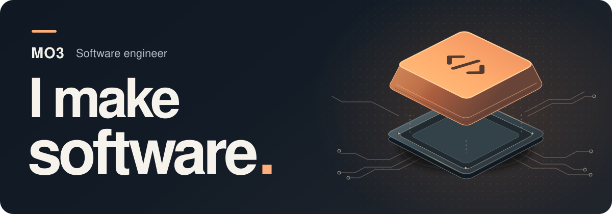

I'm **MO3**, a software engineer. I build desktop tools in Rust, write interpreters in C, and make things for the web.

## BTWN

I use two Windows PCs. I wanted to close Codex on one, open it on the other, and pick up at the same message. **BTWN** brings my local chats, project files, and sidebar along over Wi-Fi or Ethernet.

I wrote it in Rust. Before copying a file, BTWN checks whether the other PC already has it. If I've continued the same chat on both machines, it keeps both histories for review.

**[See BTWN in action](https://iamo3.github.io/BTWN/)** · [Read the source](https://github.com/iaMO3/BTWN/tree/main/src) · [Download for Windows](https://github.com/iaMO3/BTWN/releases/latest)

## More of my work

- **RecipeRave** · A recipe site I built with a teammate. Browse dishes from around the world and open one for the ingredients and instructions. [Visit RecipeRave](https://iamo3.github.io/RecipeRave/)
- **Monty** · A bytecode interpreter in C. It reads a program one instruction at a time and operates on a stack. [Explore the interpreter](https://github.com/iaMO3/monty)
